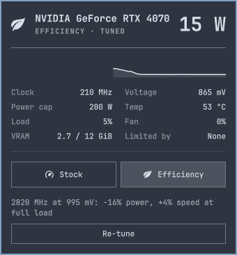

# GPU Undervolt for Omarchy

A bar widget for [Omarchy](https://omarchy.org) that shows live GPU metrics, switches
between **Stock** and **Efficiency**, and can tune an undervolt for your specific
card.



> **Use at your own risk.** Tuning runs your GPU above its stock clock for a given
> voltage, and finding the limit can crash a game or end your desktop session. This
> has been tested on one graphics card so far: see [Tested hardware](#tested-hardware).

## Install

```bash
omarchy plugin add https://github.com/PSthelyBlog/omarchy-gpu-undervolt.git --enable
```

If LACT is missing, the panel offers a **Set up** button. Nothing changes on your
GPU until you choose Efficiency: a new install stays on Stock.

To update:

```bash
omarchy plugin update io.github.psthelyblog.gpu-undervolt
```

## Remove

```bash
omarchy plugin remove io.github.psthelyblog.gpu-undervolt
```

The GPU returns to Stock as soon as the plugin unloads. Your settings and the LACT
packages stay behind, so a reinstall keeps your tuning result. To remove those too:

```bash
rm -rf ~/.local/state/gpu-undervolt     # saved profile choice and tuning result
```

LACT keeps an unused profile named `gpu-undervolt-efficiency`, which you can delete
in its GUI. If nothing else needs LACT or Deno, remove them with:

```bash
sudo systemctl disable --now lactd
sudo pacman -Rns lact deno
```

## Use

- Left click opens the panel, right click toggles the profile.
- **Tune for this GPU** in the panel finds your card's undervolt. It takes up to
  about 13 minutes at full GPU load. Save your work first.
- From a keybinding or script: `omarchy-shell gpu-undervolt.profile toggle`, or
  `set stock`, `set efficiency`, `get`, `tune`, `stopTune`.

## Dependencies and privileges

| Dependency | Package | Used for |
|---|---|---|
| [LACT](https://github.com/ilya-zlobintsev/LACT) daemon | `lact` (Arch `extra`) | Reading the GPU and applying every setting. Required. |
| [Deno](https://deno.com) | `deno` (Arch `extra`) | Running the stress load. Only needed for tuning. |

The plugin itself runs as your user. Two things run as root:

- **The Set up button**, once, after a polkit password prompt. It installs both
  packages and starts the daemon:

  ```bash
  pkexec /usr/bin/bash -c "pacman -S --needed --noconfirm -- lact deno && systemctl enable --now lactd"
  ```

  To do this yourself instead:

  ```bash
  sudo pacman -S --needed lact deno
  sudo systemctl enable --now lactd
  ```

- **`lactd`**, LACT's system service, which writes the GPU settings. Members of
  `wheel` can use its socket at `/run/lactd.sock` without a password.

Choosing Efficiency saves one profile, `gpu-undervolt-efficiency`, in LACT's config.
The plugin changes no other LACT profile. The stress load, `stress.ts`, has no
imports and needs no network access.

## Tested hardware

| GPU | Monitoring | Clock cap | Tuner |
|---|---|---|---|
| NVIDIA RTX 4070, driver 615.78.08 | Yes | Yes | Yes |
| AMD, Intel, hybrid laptops | Untested | Untested | Untested |

That RTX 4070 passed every step up to the tuner's +240 MHz ceiling, so its real limit
is unknown and no step has ever failed on real hardware. The error paths were tested
with injected faults, not a real GPU hang.

## How it works

The plugin talks to LACT's daemon over `/run/lactd.sock`. `omarchy plugin add` cannot
install root components, and LACT already provides the daemon, multi-vendor support
and reapply-on-resume.

Efficiency has three levels, and uses the best one available:

| Level | What it does | Risk |
|---|---|---|
| Tuned | The same rule on your card's tuned curve, which reaches each clock at a lower voltage | Tested on your card by the tuner |
| Clock cap | Stops climbing the stock VF curve where it stops being worth the power | None, this is the stock curve |
| Power cap | 75% of the default limit, for GPUs with no VF curve | None, but only acts above the cap |

The clock cap needs no hardcoded voltage. It stops where 1% more clock would cost
more than 3.5% more core power (P ~ f·V²), which the curve itself shows.

A tuned result only applies to the driver and vBIOS it was measured on. After an
update, Efficiency falls back to the clock cap until you re-tune.

### The tuner

1. Measures stock, to report the real cost of the result.
2. Raises the curve offset 30 MHz at a time. Each step runs at the knee of the
   tuned curve: the clock cap's rule, applied to the stock curve plus the offset.
   As the margin grows, the knee moves to a lower voltage and a higher clock, so
   the margin buys less power and more speed together, and each step tests the
   exact clock and voltage it would keep. Each step runs 45 seconds of
   `stress.ts`, a headless compute load that reaches the 200 W limit and
   alternates sustained load with bursts.
3. Stops at the first GPU error, failed load, or step where the work done per MHz
   falls more than 1% below the best step: the clock still reads as set, but the
   silicon is stretching it. It also stops at +240 MHz.
4. Backs off 30 MHz and runs a 5 minute soak, dropping further if that fails.

### Crash safety

Stock is the only state saved to disk. Efficiency is applied with LACT's
`hold_profile`, which lasts only while the plugin's connection stays open:

| Event | Result |
|---|---|
| Shell or compositor crashes | Connection drops, GPU returns to Stock, the stress load dies too |
| Hard freeze, then reboot | Boots on Stock; the hold was never saved |
| Plugin disabled | Connection closes, GPU returns to Stock |
| LACT restarts | Plugin re-applies Efficiency once it reconnects |
| Crash during a tuner step | That step counts as failed; the last good step minus 30 MHz is kept and flagged as not soak-tested |
| GPU error (Xid) while tuned | Undervolt drops 15 MHz and you get a notification |
| Session ended badly while tuned, or a GPU error the plugin did not see | Same, before anything is applied at the next login |

Any Xid counts, including ones caused by a buggy app. That can cost a little
efficiency, but it never makes the undervolt more aggressive. Each error counts
once: the login check skips errors the plugin already stepped down for. A game
crash that logs no Xid is not noticed.

Your choice is kept in `~/.local/state/gpu-undervolt/`. **Do not edit LACT profiles
during a hold**: any LACT config save writes the held profile to disk, which removes
the protection on the next boot. The plugin only edits its profile while no hold
exists. LACT also rejects `set_profile` during a hold, so changes from LACT's GUI
may fail while Efficiency is active.

To recover manually, add `lact-reset` to the kernel command line for one boot.

## Results

RTX 4070, driver 615.78.08, LACT 0.10.1, 2026-11-02, on `stress.ts`, which draws
about 200 W at stock. A full tuner run, with 45 second steps, a 5 minute soak and no
GPU errors:

| Step | Score | Watts | MHz | mV |
|---|---|---|---|---|
| Stock | 596,207 | 192.9 | 2721 | 1080 |
| Clock cap | 569,154 | 149.1 | 2576 | 995 |
| +60 MHz | 584,104 | 157.2 | 2670 | 1000 |
| +120 MHz | 600,597 | 158.5 | 2730 | 1000 |
| +180 MHz | 612,486 | 161.3 | 2790 | 1000 |
| +240 MHz (tuner ceiling) | 626,043 | 163.8 | 2850 | 1000 |
| **Saved: +210 MHz, 5 min soak** | 622,070 | 162.3 | 2816 | 1000 |

The saved result beats stock on both counts: +4% speed for -16% power. It idles
normally too, at 13 W in P8.

This run is from the first tuner, which held the stock curve's knee voltage and
spent the whole margin on clock, past the point where clock was worth its power.
The tuner now runs at the knee of the tuned curve. On this card that is 965 mV at
every offset, so if the same margin held there, +210 MHz would run at 2745 MHz:
about stock speed. That has not been measured yet.

Earlier runs used `vkmark`, whose heaviest GPU-bound scene peaks near 140 W. There,
a 150 W power cap saved nothing, which is why Efficiency is now a clock cap. These
are short runs: they measure efficiency, not long-term stability, and a compute
load is not a game.

One real game session so far: S.T.A.L.K.E.R. 2 on Proton Experimental at Epic
settings, 1080p, no frame generation, about an hour under load on the saved +210 MHz
profile. The GPU sat at the 2820 MHz cap and 1000 mV for 97% of loaded samples, at a
median of 132 W, a peak of 166 W and a peak core temperature of 71 °C. There were no
GPU errors, no step-downs and no visual glitches noticed while playing. The game
segfaulted in Proton's `ntdll.so` while exiting, after it had closed its own log.
Nothing links that to the GPU, but there is no stock session to compare it with, and
no stock power figure for this game.

## Development

```bash
node --test tests/                               # Model.js logic, real RTX 4070 curve
python3 -m unittest discover -s tests -p 'test_*.py'  # spike curve builder
python3 tests/integration.py                     # Service.qml end to end, headless, ~3 min
```

`tests/integration.py` never writes to the GPU. It pins `GPU_UNDERVOLT_SOCKET` to a
mock daemon so it cannot reach a real one, and replaces `deno`, `journalctl` and the
notifier with scripts, so GPU errors, hangs and crashes can be injected. The mock
also fails any profile edit made during a hold.

To see the UI on a machine without LACT, run `python3 tools/mock-lactd.py`: the
plugin also looks for a socket at `$XDG_RUNTIME_DIR/lactd.sock`.

To try local changes, copy the plugin files in and restart the shell. Hot reload
is not enough: `Service.qml` uses `keepLoaded`, and `Panel.qml` edits stayed stale
even when the shell logged a reload.

```bash
cp manifest.json Service.qml LactClient.qml Panel.qml Model.js stress.ts \
  ~/.config/omarchy/plugins/io.github.psthelyblog.gpu-undervolt/
omarchy restart shell
```

These change real GPU settings, and a GPU fault can end your session:

```bash
python3 tools/bounded-tune.py --max-offset 60   # real tuner, limited climb, temporary state
python3 tools/spike.py status                   # read-only
python3 tools/spike.py hold                     # power cap only
python3 tools/spike.py curve                    # writes +30 MHz at idle, checks the reset
python3 tools/spike.py measure                  # needs vkmark
```

## License

[MIT](LICENSE)
